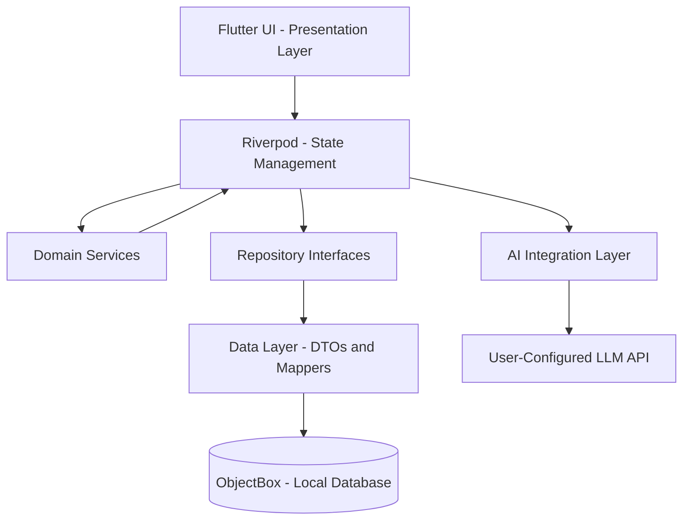

# Overman — Habit Tracking, Without the Noise

**Overman** is a Flutter-based habit-tracking application designed to help users build consistency, monitor progress, and work towards their goals without turning self-improvement into another source of screen time.

The core philosophy is simple: **track your habits, understand your progress, and get back to your life.**

Overman combines a lightweight habit-tracking system with an optional AI-powered companion that can interpret habit data, provide personalized suggestions, and motivate users through selectable character-inspired personalities. Users retain control over their data, their AI configuration, and how they choose to interact with the application.

> **Project status:** Under active development. The project follows a layered architecture, with a focus on building and verifying the data and domain layers before expanding the user interface.

---

## Table of Contents

- [Project Overview](#project-overview)
- [Core Features](#core-features)
- [AI-Powered Habit Companion](#ai-powered-habit-companion)
- [Character Personalities](#character-personalities)
- [User-Controlled AI Configuration](#user-controlled-ai-configuration)
- [Technical Architecture](#technical-architecture)
- [Habit Scheduling and Historical Accuracy](#habit-scheduling-and-historical-accuracy)
- [Data Ownership and Portability](#data-ownership-and-portability)
- [Project Structure](#project-structure)
- [Technology Stack](#technology-stack)
- [Development Principles](#development-principles)
- [Testing Strategy](#testing-strategy)
- [Getting Started](#getting-started)
- [Future Scope](#future-scope)
- [Project Goals](#project-goals)

---

## Project Overview

Many productivity applications introduce complex dashboards, constant reminders, streak anxiety, and engagement features that can distract users from the habits they are trying to build.

Overman takes a different approach.

The application is designed to supervise and support habit formation rather than demand continuous attention. Logging a habit, checking a streak, reviewing statistics, or adjusting a target should require as little effort as possible.

The optional AI layer extends this experience by turning habit history into understandable feedback and personalized motivation. Instead of offering generic advice, the AI companion can use the user's relevant habit data to discuss progress, identify patterns, and suggest practical improvements.

Overman is built around four principles:

- **Minimal friction:** Keep everyday interactions fast and straightforward.
- **Meaningful progress:** Focus on consistency, historical accuracy, and useful statistics.
- **Personalized motivation:** Allow users to choose how their AI companion communicates.
- **User ownership:** Keep habit data portable and let users configure their preferred AI endpoint.

## Core Features

### 1. Flexible Habit Tracking

Overman supports different types of habits and tracking requirements.

- **Boolean habits:** Track completion, such as reading, exercising, or meditating.
- **Numeric habits:** Record measurable progress, such as pages read, minutes exercised, or glasses of water consumed.
- **Flexible scheduling:** Configure habits for daily completion, selected weekdays, or a target number of completions per week or month.
- **Per-habit limits:** Configure targets and limits appropriate to individual habits.
- **Long-term history:** Preserve historical records for reviewing progress and evaluating past performance.

### 2. Streak Tracking

Monitor consecutive successful periods according to each habit's schedule.

Streak calculations are handled by domain logic rather than being embedded in UI components. This allows the same rules to be reused across different interfaces and tested independently.

### 3. Calendar Heatmaps

Visualize habit activity across a calendar to make consistency and gaps in activity easier to understand.

### 4. Statistics and Progress Insights

Use historical habit records to calculate relevant statistics, understand completion patterns, and review progress towards targets.

The goal is to present useful information without overwhelming users with unnecessary metrics.

### 5. Low-Friction Interactions

Overman prioritizes efficient everyday use:

- Quick habit logging.
- Clear progress indicators.
- Simple target and schedule adjustments.
- Minimal navigation for common actions.
- No requirement to interact with the AI companion to use the core tracker.

### 6. AI-Powered Habit Companion

An optional large language model (LLM) integration provides a conversational interface for reviewing habit performance, receiving suggestions, and maintaining motivation.

Users can configure a compatible model endpoint using their own API details. AI functionality is intended to complement the tracking system, not replace it.

---

## AI-Powered Habit Companion

The AI companion is designed to make habit data more useful by translating records and statistics into natural-language feedback.

### How It Works

1. **Track habits:** The user logs completions and numeric progress through the regular tracking interface.
2. **Prepare context:** Relevant habit records, targets, schedules, and derived statistics are organized into an understandable format.
3. **Apply optional personality:** If the user selects a character personality, its predefined system prompt establishes the companion's communication style.
4. **Send the request:** The prepared context and conversation are sent to the user-configured LLM endpoint.
5. **Receive personalized guidance:** The model responds with feedback, encouragement, or suggestions grounded in the supplied information.
6. **Continue the conversation:** Users can discuss their habits and goals naturally, with conversation history maintained according to the application's conversation-management logic.

The AI companion is optional. Users who prefer conventional tracking or neutral, mechanical responses can use Overman without selecting a personality.

### Character-Based Motivation

Overman introduces character-inspired personalities to make feedback more engaging and adaptable to different motivational preferences.

Depending on the selected personality, the companion may encourage the user gently, challenge them firmly, offer reflective advice, or emphasize resilience.

### Progress-Based Character Assignment

A planned extension is a progression system in which habit fulfillment and goal completion influence the characters or motivational identities assigned to a user.

The intention is to make progress feel tangible and rewarding without requiring users to spend additional time inside the application.

The specific progression rules, character unlock conditions, and assignment mechanics can be developed independently of the underlying habit-tracking engine.

---

## Character Personalities

The following personalities are planned or being developed as selectable AI companions. Each personality uses a predefined system prompt to guide the model's tone, behavior, and approach to habit improvement.

| Character | Personality and coaching style |
|---|---|
| **Sakuta Azusagawa** — *Rascal Does Not Dream* | Approachable, calm, and empathetic. Encourages open conversations about difficulties with habits and provides respectful, supportive guidance without judgment. |
| **Vegeta** — *Dragon Ball* | Proud, intense, and disciplined. Challenges the user to work harder, remain accountable, and pursue improvement with determination. |
| **Albus Dumbledore** — *Harry Potter* | Wise, patient, and reflective. Uses thoughtful guidance to help users understand setbacks, make better decisions, and develop consistency. |
| **Peter Parker / Spider-Man** — *Marvel* | Resilient, relatable, and encouraging. Emphasizes responsibility, perseverance, and the ability to get back up after difficult days. |

### Personality Design Principles

Every personality is intended to provide a distinct communication style while following common behavioral requirements:

- Stay focused on the user's habits, goals, and progress.
- Use the available habit data when making personalized observations.
- Avoid inventing achievements, streaks, or historical records.
- Provide practical and achievable suggestions.
- Remain respectful and avoid degrading or inappropriate responses.
- Treat missed goals as opportunities to reassess and improve rather than reasons for shame.
- Preserve the personality's intended tone without allowing roleplay to override safe and useful guidance.

The selected personality changes how the model communicates; it does not change the underlying habit records or calculation rules.

*Character names and associated fictional properties belong to their respective owners. These are fan-inspired personality concepts and do not imply official affiliation or endorsement.*

---

## User-Controlled AI Configuration

Overman is designed to let users configure their own AI connection rather than requiring a single hard-coded model provider.

### Settings: API for AI Suggestions

The Settings screen includes an **API for AI Suggestions** entry.

Selecting it opens a dedicated configuration screen containing:

1. **API endpoint:** An input field where the user enters the URL of their compatible model API.
2. **Model configuration:** Where supported by the configured API, users can specify the model or other required connection details.
3. **Personality selection:** An optional button or container that opens the available character personalities.
4. **Configuration management:** Save and update the connection settings as needed.

When no personality is selected, the model can use its normal conversational behavior, subject to the application's default instructions.

When a personality is selected, the corresponding predefined system prompt is included in the request context.

### Context Sent to the Model

The AI request is designed to combine:

- Relevant habit records.
- Habit types, targets, and schedules.
- Completion history and calculated statistics.
- The selected personality's system prompt, if applicable.
- The user's current message.
- Relevant conversation history.

Habit data should be provided in a structured, human-readable format so that the model can interpret it consistently.

Only the context necessary for the requested task should be sent, rather than automatically transmitting every available record in every request.

### Privacy and API Configuration

Because users can supply their own API endpoint and potentially sensitive API credentials, configuration and request handling should prioritize privacy.

- Clearly communicate what habit information is sent to the configured service.
- Keep API credentials out of source control and application logs.
- Avoid embedding private API keys in the application source code.
- Validate endpoint configuration and handle connection errors gracefully.
- Make it clear that data sent to a third-party model provider may be subject to that provider's data-handling policies.

A user-configured endpoint does not automatically guarantee compatibility with every LLM provider. Request formats, authentication requirements, and response parsing depend on the API being used.

---

## Technical Architecture

Overman follows a layered Dart architecture designed to separate business rules from persistence, state management, and presentation.

The architecture aims to ensure that changing the interface does not require rewriting habit calculations or database operations.

### Architectural Layers

**1. Domain Layer**

Contains the core business rules and application concepts.

Responsibilities include:

- Habit-related domain models and rules.
- Streak calculation.
- Statistics and progress calculation.
- Schedule evaluation.
- Habit completion and target validation.

Domain services should remain independent of Flutter widgets and persistence-specific implementation details wherever possible.

**2. Data Layer**

Responsible for storing, retrieving, and mapping application data.

Responsibilities include:

- ObjectBox-based local persistence.
- Repository implementations.
- Data transfer objects (DTOs).
- Mapping between persistence models and domain models.
- Historical habit records and configuration data.

**3. State Management Layer**

Uses Riverpod to manage application state and coordinate interactions between repositories and application logic.

Responsibilities include:

- Exposing habit data to the application.
- Coordinating updates and persistence operations.
- Managing loading, success, and error states.
- Supporting the AI configuration and conversation state.

**4. AI Integration Layer**

Provides the optional connection between habit data, conversation management, personality prompts, and the configured LLM API.

Responsibilities include:

- Preparing relevant habit context.
- Managing predefined personality prompts.
- Building requests for compatible model endpoints.
- Managing conversation history.
- Handling API responses, errors, and timeouts.

The AI layer is intended to remain separate from the core habit-tracking engine. Failure of an AI request should not prevent users from logging habits or accessing locally stored data.

### Architecture Overview



The diagram represents the intended architectural separation. Exact dependencies and implementation details may evolve as development progresses.

---

## Habit Scheduling and Historical Accuracy

A key design requirement in Overman is that changing a habit's schedule must not silently rewrite its past.

For example, suppose a user initially schedules a habit for Monday, Wednesday, and Friday, then changes it to every day.

The new schedule should apply from the effective change date forward. Earlier dates must continue to be evaluated using the schedule that was active at the time.

This principle helps preserve the integrity of:

- Historical completion records.
- Streak calculations.
- Calendar heatmaps.
- Completion statistics.
- Goal evaluation and AI-generated insights.

Schedule changes therefore need an explicit effective date and a reliable way to determine which scheduling rules apply to a historical date.

The implementation should be verified through automated tests covering schedule changes, missed days, weekly and monthly targets, and historical streak recalculation.

---

## Data Ownership and Portability

Overman is designed around the principle that users should be able to access and move their own data.

The data layer should support clear separation between domain records and storage-specific representations, making future import and export functionality easier to implement.

Planned portability capabilities include:

- Exporting habit records in a documented, structured format.
- Importing previously exported data.
- Preserving habit definitions, schedules, targets, and historical entries where supported.
- Validating imported data and reporting invalid or incompatible records.
- Keeping the core tracking functionality independent of the AI provider.

The local database provides the foundation for storing habit information on the device. Import and export formats and their compatibility guarantees will be defined as those features are implemented.

---

## Project Structure

The repository follows the standard Flutter project layout, with application logic organized under `lib/`, automated tests under `test/`, and supporting development resources at the project root.

```text
habit_tracker/
├── android/                    # Android platform project
├── assets/
│   └── persona_dps/             # Personality-related assets
├── ios/                        # iOS platform project
├── lib/                        # Main Dart application code
│   ├── domain/                 # Domain models and business rules
│   ├── data/                   # Persistence, repositories and mapping
│   ├── application/            # Application services and state
│   └── ...                     # Additional modules as implemented
├── linux/                      # Linux platform project
├── macos/                      # macOS platform project
├── skills/                     # Project-specific development resources
├── test/                       # Automated tests
├── tool/                       # Development and verification tools
├── web/                        # Web platform project
├── windows/                    # Windows platform project
├── habit_tracker_backend_prompts.md
├── analysis_options.yaml        # Dart analysis configuration
├── pubspec.yaml                # Dependencies and Flutter configuration
├── pubspec.lock                # Resolved dependency versions
└── README.md
```

*Note: The tree illustrates the project's organization at a high level. The exact internal structure under `lib/` should reflect the current repository implementation.*

---

## Technology Stack

| Technology | Purpose |
|---|---|
| **Flutter** | Cross-platform application framework |
| **Dart** | Primary programming language |
| **ObjectBox** | Local database and persistence |
| **Riverpod** | State management and dependency coordination |
| **LLM API integration** | Conversational guidance and personalized suggestions |
| **Dart testing tools** | Unit and integration testing |

The selected stack supports a local-first tracking foundation, reusable domain logic, and an optional AI integration without making the core application dependent on a remote model service.

---

## Development Principles

Overman's implementation follows several engineering principles.

### Test Before Expanding the UI

Domain logic, persistence operations, schedule evaluation, streak calculations, and statistics should be tested before depending on them in presentation code.

### Keep Business Rules Out of Widgets

Widgets should display state and handle user interactions. They should not independently implement streak formulas, schedule rules, or historical calculations.

### Treat History as Data, Not a Reconstructed Guess

Historical results should be calculated from recorded events and the rules applicable at the relevant time, rather than blindly applying today's configuration to every previous date.

### Keep AI Optional

Habit creation, completion logging, local history, and progress calculations must work independently of network availability and LLM configuration.

### Handle Failure Gracefully

Invalid configuration, persistence errors, interrupted requests, and model API failures should be handled without corrupting habit history or blocking unrelated tracking operations.

### Minimize Unnecessary Engagement

The application should help users spend less time managing their habits, not encourage endless interaction through unnecessary feeds, notifications, or conversational features.

---

## Testing Strategy

Testing is a core part of Overman's development process.

The goal is to verify the underlying behavior before building additional presentation features on top of it.

| Test area | What should be verified |
|---|---|
| Domain models | Validation and correct handling of habit types and targets |
| Scheduling | Daily, weekday-based, weekly, and monthly evaluation |
| Historical rules | Schedule changes preserve previous evaluations |
| Streaks | Correct handling of successful periods, missed periods, and schedule changes |
| Statistics | Accurate calculations from stored historical records |
| Persistence | Correct creation, retrieval, update, and deletion of records |
| Repositories | Correct mapping and interaction between domain and data layers |
| AI configuration | Input validation, persistence, and configuration updates |
| Personality prompts | Correct prompt selection and consistent request construction |
| AI conversations | Message history, error handling, and conversation restoration |
| Integration | Reliable coordination between state management, repositories, and services |

The project aims to maintain a reliable test suite as the application evolves. Individual test areas should be marked complete only after their relevant cases have been implemented and verified.

---

## Getting Started

### Prerequisites

Install the following tools:

- [Flutter SDK](https://docs.flutter.dev/get-started/install)
- [Dart SDK](https://dart.dev/get-dart) — included with Flutter
- [Git](https://git-scm.com/downloads)
- An appropriate IDE, such as [Android Studio](https://developer.android.com/studio) or [Visual Studio Code](https://code.visualstudio.com/)

### Installation

Clone the repository:

```bash
git clone <repository-url>
cd habit_tracker
```

Install dependencies:

```bash
flutter pub get
```

Check the Flutter development environment:

```bash
flutter doctor
```

Run static analysis:

```bash
flutter analyze
```

Run the test suite:

```bash
flutter test
```

Launch the application on a connected device or available emulator:

```bash
flutter run
```

Replace `<repository-url>` with the actual Git repository URL.

### ObjectBox Setup

If the current ObjectBox configuration requires code generation, run the generator command specified by the project's dependencies and configuration. Verify the repository's existing setup before introducing or changing generation commands.

### AI Configuration

AI functionality requires a compatible API endpoint and any authentication or model configuration required by that endpoint.

The exact setup depends on the provider and the implementation available in the current version. Users should not need an AI API configuration to use the core habit-tracking features.

---

## Future Scope

The following improvements are potential extensions of the project and should be considered planned work unless already implemented and tested.

- **Character progression system:** Assign or unlock motivational characters based on habit fulfillment and goal completion.
- **Advanced goal coaching:** Help users break larger goals into manageable actions and review their progress efficiently.
- **Improved AI insights:** Identify recurring patterns and provide context-aware suggestions based on historical data.
- **Custom personalities:** Allow users to define additional communication styles and, where appropriate, configure their own prompts.
- **Data import and export:** Provide reliable, documented formats for moving personal habit data between devices or applications.
- **Expanded statistics:** Add useful long-term trends and comparisons without overcomplicating the interface.
- **Additional platform support:** Refine the experience across supported mobile and desktop platforms.
- **Privacy enhancements:** Improve credential handling, data minimization, endpoint validation, and user visibility into information sent to external services.

Future AI-based goal planning should remain a separate capability from routine habit logging. The tracker should continue to work as a lightweight standalone application.

---

## Project Goals

Overman is being developed to demonstrate how a practical habit-tracking application can combine clean software architecture, reliable data handling, and optional AI-driven personalization.

Its primary goals are to:

1. Build a dependable habit-tracking foundation with accurate scheduling, history, streaks, and statistics.
2. Maintain a modular Dart architecture with clearly separated domain, data, state, and AI responsibilities.
3. Verify important business rules through automated testing.
4. Provide a user-controlled AI companion that adapts its communication style to individual preferences.
5. Preserve user control over habit data and model configuration.
6. Deliver a low-friction experience that encourages real-world action rather than prolonged screen engagement.

**Overman's objective is not to make users spend more time in a productivity app. It is to help them make progress, understand their consistency, and return to what matters outside the screen.**

---

*Developed as a Flutter application project. Features and implementation details are subject to change during active development.*
